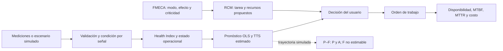

# TEEPARCIAL3 — Plataforma de mantenimiento basado en condición

**Grupo 1**  
**Gestión de Mantenimiento 2026-II**  
**Universidad de La Sabana**

## Acceso a la plataforma

**Repositorio público:** [github.com/Luis3070/TEEPARCIAL3](https://github.com/Luis3070/TEEPARCIAL3). El código y los entregables están publicados.

**Aplicación web:** [Abrir TEEPARCIAL3 en GitHub Pages](https://luis3070.github.io/TEEPARCIAL3/). Verificada por HTTPS, responde sin autenticación y funciona en el navegador sin instalación.

La aplicación funciona en el navegador y no requiere FastAPI, base de datos externa ni credenciales.

## ¿Qué es?

TEEPARCIAL3 es una plataforma académica de **mantenimiento basado en condición (CBM)** y **Prognostics and Health Management (PHM)** para apoyar la evaluación de un bus de transporte de personas. El Chevrolet MS 4.9 Euro VI con motor Isuzu 4HK1-TCS se utiliza como activo representativo del caso; no se afirma que sea una unidad real instrumentada ni que se haya confirmado su VIN.

## ¿Para qué sirve?

La aplicación permite monitorear señales de condición, detectar estados potencialmente anormales, valorar criticidad, visualizar tendencias y un tiempo estimado hasta alarma, sugerir tareas RCM, generar órdenes de trabajo y observar indicadores de mantenimiento. Estos resultados ayudan a discutir decisiones académicas; no autorizan por sí solos una intervención ni la liberación de un vehículo real.

## ¿Cómo funciona?

La secuencia funcional es **Datos → Evaluación de condición → Health Index → Pronóstico → Decisión → Orden de trabajo → Indicadores**. La FMECA estructura modos de falla, efectos y criticidad; RCM vincula cada modo con una tarea propuesta. La curva P–F se representa conceptualmente: se estima P (alerta) y A (alarma/detención) dentro de escenarios simulados. El punto F (falla funcional) no está definido con datos de este proyecto.



La aplicación es un frontend React + TypeScript + Vite. Las series, evaluaciones, simulación, pronóstico y órdenes se calculan en el navegador. La navegación se realiza dentro de la aplicación y no depende de rutas de servidor.

## Variables monitoreadas

| Variable | Unidad | Componente | Modo de falla asociado | Función y uso |
|---|---|---|---|---|
| Temperatura del refrigerante | °C | Motor, radiador y circuito de refrigeración | Pérdida de transferencia térmica o fuga | Mantener el motor en su envolvente térmica; señal principal del caso dinámico |
| Presión de aceite | bar | Bomba, filtro, galerías y cojinetes | Presión insuficiente por fuga, desgaste o pérdida de bombeo | Sostener la película de lubricación |
| Espesor de material de fricción | mm | Frenos de servicio, por rueda | Desgaste por debajo del límite autorizado | Producir par de frenado suficiente |
| Presión fría del neumático | psi | Neumático, válvula y conjunto de rueda | Pérdida de presión o daño | Soportar la carga y transmitir fuerzas al camino |
| Consumo normalizado | L/100 km | Operación y combustión | Aumento de consumo o pérdida de eficiencia | Indicador contextual de operación; se excluye del HI y no detiene automáticamente porque no prueba por sí solo una falla mecánica |
| Voltaje del banco de baterías | V | Batería, conexiones y sistema de carga | Pérdida de capacidad o de carga | Proveer energía para arranque y funciones eléctricas |

## Fundamento matemático

- **Normalización de condición:** cada señal se compara con una referencia saludable y su umbral de alarma, respetando si la condición adversa es un valor alto o bajo. La salud por variable se limita al rango 0–100.
- **Health Index (HI):** promedio ponderado por los RPN provisionales de cinco señales de condición, con cobertura reportada y mínimo de cuatro señales válidas. El consumo es contextual y queda fuera del índice. **El HI no es una probabilidad de supervivencia.**
- **Estado operacional:** se evalúa por separado a partir de la condición crítica más severa válida y de la suficiencia de datos; no se infiere únicamente del HI.
- **Pronóstico OLS:** extrapola una tendencia lineal de observaciones históricas disponibles. Es una **extrapolación no calibrada**, no un pronóstico probabilístico. Si queda muy lejos del horizonte observado, su confiabilidad puede ser baja.
- **Tiempo hasta alarma (TTS):** tiempo estimado por la tendencia hasta alcanzar el umbral de alarma. Es una estimación en horas, no una fecha garantizada de intervención.
- **Intervalo P–A:** diferencia simulada entre primer cruce de alerta P y alarma A, `ΔPA = tA − tP`. Las trayectorias sin ambos cruces se censuran. **P–A no es P–F**: el tiempo hasta falla funcional F no se estima.
- **Disponibilidad operacional:** tiempo de servicio menos pasos con alarma crítica, dividido por el tiempo de servicio requerido. La simulación avanza en pasos reportados de una hora.
- **MTBF:** tiempo de operación dividido por fallas funcionales explícitas. Si no hay fallas funcionales registradas, se informa como no estimable.
- **MTTR:** promedio de duración activa de reparaciones correctivas completadas. Las intervenciones preventivas simuladas no cuentan como reparaciones; las detenciones que siguen abiertas al cierre se reportan como censuradas.
- **Costos:** estimación demostrativa basada en COP 250.000 por intervención y COP 45.000 por hora de indisponibilidad. Son supuestos, no costos contables de una operación real.

Los umbrales y pesos asociados a FMECA/RCM son provisionales. La referencia hallada para presión de aceite corresponde a una prueba de servicio en aplicación/régimen específico y no se traslada como límite aprobado del bus.

## Demostración recomendada

Recorrido sugerido de menos de cinco minutos:

1. Abrir la plataforma y consultar el estado nominal.
2. Elegir el escenario de pérdida de capacidad térmica (`COOLING_DRIFT`).
3. Ejecutar la simulación y avanzar hasta observar la alerta.
4. Revisar tendencia y TTS; leer su aviso de extrapolación no calibrada.
5. Consultar el modo de falla FMECA y la tarea RCM asociada.
6. Generar una orden de trabajo.
7. Avanzar hasta detención o ejecutar la intervención preventiva.
8. Observar la recuperación térmica simulada y los indicadores.

La recuperación dinámica de intervención está validada para refrigeración; no se garantiza para todos los subsistemas.

## Resultados y validación

La revisión G2 incluye **150 corridas sintéticas**: cinco escenarios, 30 semillas por escenario y 180 horas por corrida; **19 pruebas automatizadas** aprobadas; compilación de producción aprobada y recorrido funcional manual en navegador. Las importaciones de las plantillas CSV y XLSX, el escenario térmico, la intervención y los KPI se comprobaron manualmente. No se afirma una prueba E2E automatizada ni validación de campo.

La comparación pareada OLS–exponencial muestra que ningún método domina todas las señales. En refrigeración (`COOLING_DRIFT`, n=3291 comparaciones), OLS obtuvo MAE/RMSE de 39,69/52,88 h y sesgo +36,73 h; el exponencial, 25,85/41,10 h, cobertura 94,8% y sesgo −24,29 h. En aceite combinado, el exponencial reduce MAE/RMSE frente a OLS (260,23/3426,54 h frente a 138,75/1200,73 h); en freno combinado empeora (OLS 4,25/5,40 h; exponencial 34,74/47,71 h). OLS se conserva en la interfaz por esa variación, no por superioridad general.

Una auditoría independiente simulada reportó error medio OLS al alcanzar P de **+4,67 h en refrigeración, +2,59 h en lubricación y +3,75 h en frenado**. Para refrigerante, el percentil 95 del error optimista fue 99,06 h; las estimaciones lejanas requieren cautela.

El intervalo P–A se calcula únicamente cuando una corrida observa ambos cruces y conserva las corridas censuradas. El experimento exploratorio de políticas registró 30 pares: reactiva, disponibilidad 98,96% y COP 334.000; CBM-TTS, 98,85% y COP 343.000. **No demuestra superioridad económica del CBM.** En 14 de 60 registros la indisponibilidad fue inferior a las dos horas configuradas: la intervención continua se contabiliza con muestras discretas de una hora, por lo que la comparación de disponibilidad es exploratoria y no permite concluir ventaja de costo o disponibilidad. También se corrigió la exportación del campo `TTS_OLS_h` que faltaba en las 30 filas CBM; la columna se recalcula desde OLS en el cruce P, cuando existe. Véase el detalle de QA.

La estabilidad numérica del modelo térmico y las pruebas de software no constituyen calibración física. Ningún resultado demuestra desempeño predictivo en flota.

## Datos y procedencia

La aplicación distingue procedencia de datos:

- `MEASURED`: medición observada y registrada.
- `INFERRED`: valor derivado de otras observaciones o un método documentado.
- `ASSUMED`: parámetro o umbral adoptado como supuesto.
- `SIMULATED`: dato generado por el escenario del modelo.
- `UNKNOWN`: origen no declarado o desconocido.

Para importar, abrir **Datos → Seleccionar CSV o Excel**. Se aceptan CSV/XLSX con columnas `t` (horas), `variableId` y `value`; `unit` y `dataOrigin` son opcionales. Sin origen declarado, se asigna `UNKNOWN`. Las órdenes de trabajo y los datos se guardan localmente en el navegador; no se sincronizan entre dispositivos ni se transmiten a un servidor.

## Documentación y entregables

- [Informe técnico (PDF)](ENTREGA_FINAL/Informe_tecnico_TEEPARCIAL3.pdf)
- [Informe técnico editable (DOCX)](ENTREGA_FINAL/Informe_tecnico_TEEPARCIAL3.docx)
- [Matriz de rúbrica (CSV)](ENTREGA_FINAL/MATRIZ_RUBRICA.csv)
- [Fuentes y supuestos](ENTREGA_FINAL/FUENTES_Y_SUPUESTOS.md)
- [Guía de sustentación](ENTREGA_FINAL/GUIA_SUSTENTACION.md)
- [Manual de ejecución](ENTREGA_FINAL/MANUAL_EJECUCION.md)
- [Plantilla de observaciones (CSV)](ENTREGA_FINAL/Plantilla_observaciones.csv)
- [Plantilla de mediciones (XLSX)](ENTREGA_FINAL/Plantilla_mediciones.xlsx)
- [Resumen de revisión G2](REVISION_G2/00_RESUMEN_G2.md)
- [Métricas de pronóstico](REVISION_G2/01_METRICAS_PRONOSTICO.csv)
- [Intervalos P–A / P–F](REVISION_G2/02_INTERVALOS_PA_PF.csv)
- [QA G2 y release](REVISION_G2/06_QA.md)
- [Comparación OLS–exponencial](REVISION_G2/07_COMPARACION_OLS_EXPONENCIAL.csv)
- [Release final](RELEASE_FINAL.md)

Los documentos fuente académicos de terceros se referencian y resumen, pero no se redistribuyen en este paquete.

## Limitaciones

- Los datos experimentales son predominantemente simulados.
- Algunos umbrales, costos, tareas y pesos FMECA/RCM son supuestos preliminares.
- No se confirmó VIN ni configuración exacta del bus.
- No hay calibración OEM integral ni validación en campo.
- Los pronósticos son deterministas y no probabilísticos; el OLS no está calibrado y extrapola tendencias observadas.
- P–A es simulado; P–F no es estimable con la evidencia disponible.
- La intervención dinámica se validó para refrigeración, no necesariamente para todos los subsistemas.
- Aplicación académica: no está destinada al control, despacho, reparación ni liberación operacional de un bus real.

## Ejecución local

**Requisitos:** Node.js 22 recomendado y npm. Desde la raíz del repositorio:

```powershell
cd frontend
npm ci
npm test -- --run
npm run dev
```

Para generar el sitio estático:

```powershell
npm run build
```

El resultado se genera en `frontend/dist`. En GitHub Actions se configura la base `/TEEPARCIAL3/` para el repositorio de publicación; localmente Vite utiliza `/`.
